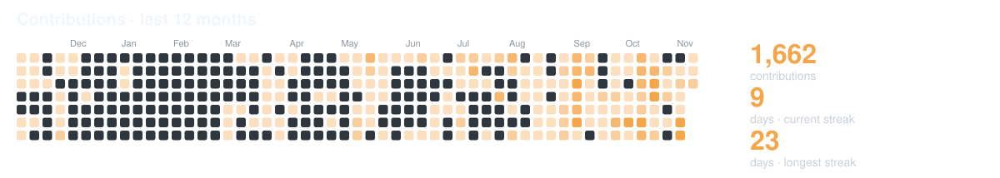
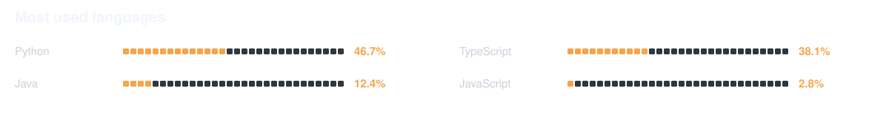

<!-- HEADER -->

  

  
  

## 🛰️ Now

**AI Engineer Intern @ InSalud**, a network of medical centers in 5 countries. I build the WhatsApp agents that book appointments, and I make sure they actually improve the operation.

## 🚀 Featured Projects

<table>
<tr><td>

**GenAI SaaS for content creators**, built solo end to end.

`FastAPI` · `LangGraph` · `Groq` · `Gemini` · `Qdrant` · `Supabase` · `Next.js 16`

- 🔁 Corrective RAG (CRAG) with query rewriting and automatic web-search fallback
- 🧱 8 automated test suites · CI with 3 checks · streaming multi-chat

  

</td></tr>
<tr><td>

**EdTech platform to choose professors with data, not rumors.** I owned the AI layer end to end.

`Next.js` · `FastAPI` · `PostgreSQL + pgvector` · `Celery` · `Cohere` · `Gemini`

- 🧠 RAG assistant with a grounding layer that catches invented names before answering
- 📊 **SUS 87.5/100** · load test **0% errors, p95 1.4s** @ 50 concurrent users

  
  

</td></tr>
<tr><td>

**WhatsApp quoting and operations platform for an events company in Lima.** A real client project, currently in development.

`FastAPI` · `PostgreSQL 16` · `Redis 7` · `Chatwoot` · `WhatsApp Cloud API` · `Next.js 16`

- 💬 Customers get a quote on WhatsApp in seconds, without waiting for a human
- 🧱 Hexagonal architecture · 12 operational control processes · RBAC + JWT · signed PDF contracts

  
  
  

</td></tr>
<tr><td>

**Multi-agent AI tutor for Prompt Engineering**, built at *Hack-Nation 2025* (global AI hackathon, team of 3, 48h). I led integration and built the RAG pipeline.

`Next.js 15` · `Flask` · `LangGraph` · `Azure OpenAI` · `Azure AI Search`

- 🕸️ **8 specialized agents** on a LangGraph state graph
- ☁️ **4 Azure services** integrated (OpenAI, AI Search, Document Intelligence, Speech)

  

</td></tr>
</table>

<b>📂 More projects</b>

 

| Project | What it is | Links |
|---------|-----------|-------|
| **AgentUP** | RAG agent over company docs that answers only from its sources and cites them; Dockerized for Cloud Run |  |
| **Flight Price Tracker** | Scheduled GitHub Actions job that tracks flight prices with SerpAPI and sends Telegram alerts |  |
| **Data Mining Labs** | Credit-risk model on the Home Credit dataset, following CRISP-DM |  |

## 📊 Activity

## 🛠️ Stack

  

  
  
  
  
  
  
  

